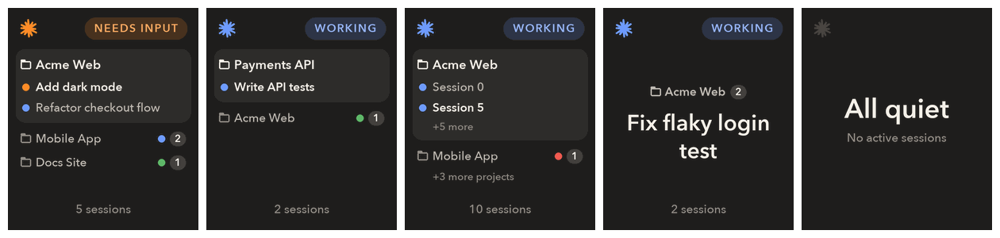
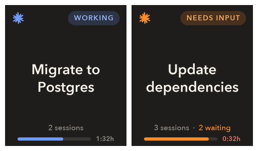

# busytag-claude-manager

**A desk-side status light for your Claude Code sessions.** Shows your active Claude Code sessions (desktop Code tab and CLI) and Cowork sessions on a [Busy Tag](https://www.busy-tag.com/). It displays each session's short name and status, and flashes the LEDs orange twice when a session needs your input.

> **Unofficial.** This is a personal side project. It is not affiliated with, endorsed by or supported by Anthropic or the makers of Busy Tag. "Claude" and "Busy Tag" are trademarks of their respective owners.



## Why

Claude Code is at its best when you let it run: start a task, start another in a second session, and go do something else. The catch is that an agent is only as fast as its slowest human reply. A session that hits a permission prompt or asks a question just sits there, and you don't find out until you happen to switch back to the window. With three or four sessions open, you either lose minutes to blocked agents or you keep tabbing over to check on them, which breaks the focus you were trying to protect.

busytag-claude moves that check off the screen and onto your desk:
- **Never miss a blocked session.** When any session needs input, the ring flashes orange and that session is pinned on the screen until you answer, so a waiting agent can't hide behind the others.
- **Read state at a glance.** Blue means working, orange means waiting for you, green means done, red means it failed (for example, you hit the usage limit). You can read it from the corner of your eye without leaving what you're doing.
- **Keep track of parallel work.** Sessions are grouped by project, with their titles, a count of how many are waiting, and which one changed last. Running five agents across three repos stays manageable.
- **Know your budget.** A bar along the bottom shows how much of your 5-hour session limit is left and when it resets, so you can plan a long task before you start it.
- **Zero per-session setup.** It hooks into Claude Code once at install time. Every new session, in the desktop app or the CLI, shows up on its own and disappears when it's done.



## How it works

Claude Code [hooks](https://docs.claude.com/en/docs/claude-code/hooks) send each session's lifecycle events (prompt submitted, tool use, permission request, stop) to a small local daemon. The hook is fire-and-forget: it returns in milliseconds and exits cleanly even when the daemon or device is missing, so it never slows Claude down. The daemon keeps the state of every session, renders the screen and drives the LED ring over USB. Everything runs locally; the only network call is the usage-limit check to Anthropic's own endpoint, and prompts and tool data are never stored.

```
Claude Code ──hook──► busytag_claude/hook.py ──HTTP 127.0.0.1:47621──► daemon ──USB serial──► Busy Tag
Cowork ──audit.jsonl──────────────────────────────────────────────────┘ (polled every second)
```

**Cowork.** Cowork gives each session its own Claude Code config, so the hooks don't run there. Instead the daemon reads the log the Claude app keeps for each Cowork session (`~/Library/Application Support/Claude/local-agent-mode-sessions/…/audit.jsonl`), reading only new lines and only status records. A Cowork session shows its Cowork title, and its project is the folder you gave it, or `Cowork` if none. Archiving it in the app removes it from the screen within 30 s. Set `"cowork": false` to turn this off.

## Install (macOS)

```bash
./install.sh
```

The installer:
- creates `.venv`
- writes `~/.config/busytag-claude/config.json`
- adds hooks to `~/.claude/settings.json`, after writing a backup
- starts a launchd agent

**Sharing the device with the Busy Tag app.** Only one program can own the USB port, so the daemon takes turns with the app automatically:
- When a session starts **working** or **needs input**, the daemon quits the Busy Tag app and takes the device. The first screen appears about 3–4 s later.
- After `handback_after_minutes` (default 3) with no session working or waiting, it turns the LEDs off, releases the device and reopens the app in the background. Teams, Calendar and the app's other integrations then work as usual.
- Set `"manage_busytag_app": false` to turn this off. The daemon then never touches the app, and you quit it yourself.

**Or run it as a Busy Tag app integration.** Set `"transport": "app"` and the app keeps the device; the daemon is never in its way. The status shows through a **Claude Sessions** plugin inside the Busy Tag app, next to Teams, Calendar and the app's other integrations:
1. Set `"transport": "app"` in the config, then run `./install.sh` again. It builds `dist/ClaudeSessions.busytagplugin` and opens it in the app. To build it on its own, run `./make_plugin.sh`.
2. In the Busy Tag app, enable **Claude Sessions**.

The plugin asks the daemon for the current screen and LED state once a second (`GET /frame`) and shows them on the tag. Limits:
- The status only shows while the app has the plugin on screen. The app rotates enabled plugins, so to see it all the time, make it the only enabled plugin or give it a long display time. While another plugin is on screen, a session that needs input doesn't flash.
- The ring has no fades, and display brightness is set in the app.
- The settings page's live preview shows on the tag only while the plugin is on screen.

Uninstall: `./uninstall.sh`. This removes the hooks and the agent. Your config and logs are kept.

## Statuses

| Screen | LEDs | Claude Code hook | Cowork log record |
|---|---|---|---|
| Working | dim blue dot slowly circling the dark ring (~7.6 s per lap) | UserPromptSubmit, Pre/PostToolUse | `user`, `assistant`, permission answered |
| Needs input | 2 orange flashes, then solid orange | PermissionRequest (also fires for questions), Notification `permission_prompt` | `permission_request` (also questions) |
| Done | dark green | Stop | `result` |
| Error (e.g. usage limit reached) | 2 bright red flashes, then dim red | StopFailure | `result` with `is_error` |
| Ready | (none) | SessionStart | |
| No active sessions | off | (no sessions) | |

- **When the screen changes:** only when you send a message or a session answers (or asks you something). Typing in the chat box, opening a new chat, tool calls and title changes don't redraw it.
- **Several sessions:** the screen highlights the session whose status changed last. The LED ring shows that same session's status. A session that needs input stays pinned until answered; if several wait, the one waiting longest is highlighted. While it waits and another session works, the bottom LED (`input_led`) stays orange and the working dot circles the rest of the ring. The footer shows the total and `N waiting`. Sessions are saved to `~/.config/busytag-claude/sessions.json`, so a waiting session isn't forgotten when the daemon restarts.
- **Several projects:** with sessions in 2+ projects the screen becomes a list. The highlighted session's project is a card listing its sessions (status dot, current one in bold); the other projects follow as rows with their most urgent status and session count.
- **New chats:** a session appears once you send its first message.
- **Names:** the desktop session title (from the transcript), or the project name. Duplicates get ` #n`.
- **Session limit bar:** 5-hour usage and time to reset. The installer sets Claude Code's status line to `statusline.py`, which forwards the limits Claude Code gets with every response, so the bar is live while you use the `claude` CLI (an existing status line of your own is left alone). The desktop app doesn't run status lines; then the daemon polls the usage endpoint every 2 minutes with the CLI's keychain token. Only the CLI refreshes that token, so when it has expired the daemon runs `claude -p` once (a one-word Haiku reply, no hooks, not saved to your history) to refresh it. With an expired token the endpoint answers 429 rather than 401. The bar is green while more than 50% is left, blue down to 20%, orange below 20%, and red once none is left, until the limit resets. A reading older than 10 minutes turns the bar grey.
- **Project:** shown above the session name. It comes from `project_names` in the config, else the Claude app's preset name for that folder, else the folder name. Worktrees count as their parent project.

## Project names

Each session is grouped under a project name. The daemon picks the first match from:
1. `project_names` in `~/.config/busytag-claude/config.json`
2. the name you gave that folder in the Claude desktop app
3. the folder name

The Claude desktop app only knows names for folders you've opened there. So CLI sessions, and folders you never named in the app, show the raw folder name, like `web-v2-final` or `untitled folder 3`. You can fix this by hand with `project_names`, or let Claude Code do it for you.

**Name them once.** Open Claude Code in any folder and paste this:

```text
I use busytag-claude, which shows my Claude Code sessions on a Busy Tag and
groups them by project. Projects without a name in the Claude desktop app show
their raw folder name. Please give them readable names:

1. Find the folders I run Claude Code in: decode the folder names under
   ~/.claude/projects/ (each is a cwd with "/", spaces and dots replaced by
   "-", so check which real paths exist on disk), and add any folders from
   ~/Library/Application Support/Claude/ccd-session-presets.json.
   Treat <project>/.claude/worktrees/... as <project>.
2. Skip folders that already have a name in the presets file or in
   "project_names" in ~/.config/busytag-claude/config.json.
3. For each remaining folder, read its README, package.json, pyproject.toml or
   similar to suggest a short display name (max ~20 characters, Title Case).
4. Show me the list as a table (path -> suggested name) and wait for my edits.
5. Then merge the approved names into "project_names" in that config, using
   "~/..." paths, without touching any other setting, and restart the agent:
   launchctl kickstart -k gui/$(id -u)/com.busytag.claude
```

**Keep them named automatically.** To rerun this whenever you start new projects, ask Claude Code to turn it into a reusable command:

```text
Create a personal Claude Code skill at ~/.claude/skills/name-projects/SKILL.md
that does the following, so I can run /name-projects whenever I start new
projects: <paste the numbered steps from the prompt above>
```

After that, run `/name-projects` in any Claude Code session. It only suggests names for folders that don't have one yet, and nothing changes until you approve the list.

## LED settings app

Double-click **Busy Tag Settings** in `~/Applications` (or find it with Spotlight). You don't need Claude open. It starts the daemon if it isn't running and opens the settings page at `http://127.0.0.1:47621/`.

For each state (Working, Needs input, Done, Error), the page sets:
- the ring's colour and brightness
- for Working, whether a dot circles the ring or the whole ring lights
- for Needs input, whether the ring flashes first

Changes save to your config straight away and apply without a restart. Dragging a slider previews the colour on the tag for a few seconds. Previews only work while the daemon has the tag, not while it's handed back to the Busy Tag app.

`./install.sh` builds the app. To rebuild it on its own, run `./make_settings_app.sh`.

## Config

Edit `~/.config/busytag-claude/config.json`; see `config.example.json` for every option. The main ones:
- `flash_on_input`
- `flash_color`
- `colors`
- `brightness`
- `device_port`
- `transport`: `"usb"` (default) or `"app"` (through the Busy Tag app plugin, see above)
- `handback_after_minutes` (`null` = never hand back)
- `manage_busytag_app`
- `cowork`: also show Cowork sessions (default `true`)
- `project_names`: rename projects on screen, e.g. `{"~/code/acme-web": "Acme Web"}`. A path covers its subfolders; a bare folder name matches that folder anywhere.

Restart the agent to apply changes:

```bash
launchctl kickstart -k gui/$(id -u)/com.busytag.claude
```

## Debug

- `curl -s http://127.0.0.1:47621/status` shows the current sessions and screen.
- `~/Library/Logs/busytag-claude/daemon.log` is the daemon log.
- `~/Library/Logs/busytag-claude/events.jsonl` logs status changes only (no prompts or tool data). It's used for the response-time metric.
- Run in the foreground: `.venv/bin/python -m busytag_claude.daemon`

## Tests

```bash
.venv/bin/pip install pytest && .venv/bin/python -m pytest -q
```
